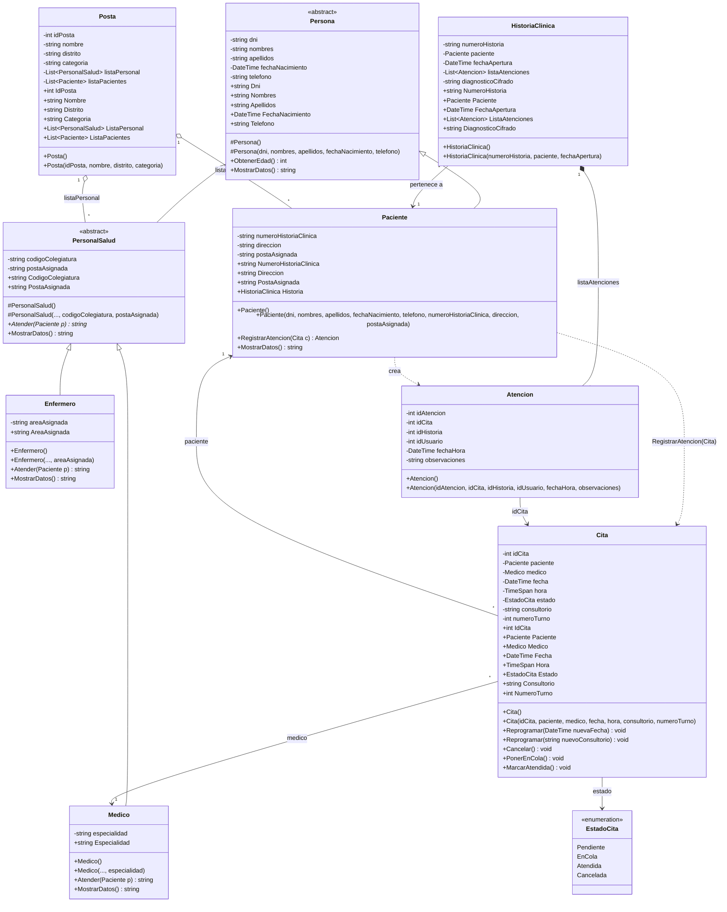

# Diagrama de clases – Entidades (SIGEPOSTA, módulo de Admisión)

Namespace: `SigepostaAdmision.Entidades`

**Leyenda:** `-` privado, `+` público, `#` protegido, `~` interno, `*` método abstracto,
`<|--` herencia, `-->` asociación, `o--` agregación, `..>` dependencia.
La clase auxiliar interna `Validacion` (validaciones comunes de los `set`) no se incluye porque no es una entidad del dominio.
